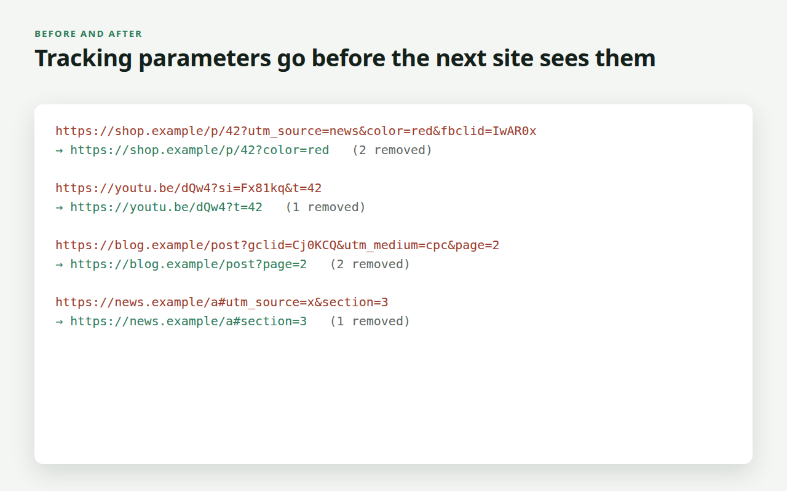

# Linkrinse Lite by PN Scripts

A free Manifest V3 extension for Firefox and Chrome that removes tracking
parameters (`utm_*`, `fbclid`, `gclid`, `mc_eid`, `igshid` and 33 more) from
the links you click and from the address bar. It works offline, asks only for
the `storage` permission and sends nothing anywhere.

The rules engine is also an npm package, `@pnscripts/linkrinse-lite`, for
cleaning URLs in Node or in your own scripts.



## What it does

- **Clean on click.** Just before a left or middle click follows a link, its
  address is rewritten without tracking parameters, so they never reach the
  next site.
- **Clean address bar.** When a page opens with tracking parameters, the
  address is replaced with `history.replaceState` (no reload), so what you
  copy or bookmark is clean.
- **38 built-in rules.** Campaign tags (`utm_*`), ad click identifiers
  (`fbclid`, `gclid`, `msclkid`, `ttclid` …), e-mail platform tags (`mc_eid`,
  `_hsenc`, `mkt_tok` …), share ids (`igshid`, `igsh`) and five site-scoped
  rules (`si` on YouTube and Spotify, `ref_src` on X, `smid` on nytimes.com,
  `spm` on AliExpress). The popup lists them all.
- **Pause on this site.** One click in the popup stops Linkrinse Lite on the
  site you are on (and its subdomains); everywhere else it keeps cleaning.
- **Careful by design.** Only the listed tracking parameters are removed.
  Sign-in, search, sorting and app parameters are never touched; tests check
  Google and Microsoft sign-in, GitHub OAuth, Google Search, Amazon review
  sorting, Reddit search, Gmail, Twitch and YouTube addresses stay exactly as
  they are (the pages aggressive cleaners are known to break).
- **Two switches, a pause and a counter** in the popup. That is the whole
  interface.

Lite is complete for what it does and never asks for payment. The full
edition, Linkrinse, adds editable rules, redirect-page skipping, a link tester
and "Copy clean link"; see https://pnscripts.com/marketplace/browser-linkrinse.

## Install

- Firefox (desktop and Android): addons.mozilla.org (in review), or load
  `dist/linkrinse-lite-firefox-1.1.0.zip` from `about:debugging`.
- Chrome and Edge: Chrome Web Store (coming soon), or "Load unpacked" with
  `dist/chrome` from `chrome://extensions` in Developer mode.

## npm

```js
const { cleanUrl } = require('@pnscripts/linkrinse-lite');
cleanUrl('https://shop.example/p?utm_source=news&color=red&fbclid=x');
// { url: 'https://shop.example/p?color=red', changed: true, removed: ['utm_source', 'fbclid'], skipped: null }
```

`cleanUrl(url)` returns the input unchanged (`changed: false`) when there is
nothing to remove, and `skipped: 'invalid' | 'not-http'` for input it does not
touch. TypeScript types are included.

## Develop

```
npm test            # unit and packaging tests (node --test)
node tools/e2e-chrome.mjs    # real Chrome: cleaning, counter, popup pause (PN_PLAYWRIGHT=…/playwright-core)
node tools/e2e-firefox.mjs   # real Firefox via web-ext (WEB_EXT=…/web-ext)
npm run build       # dist/chrome, dist/firefox, both zips and the npm tarball
npm run images      # store images at exact sizes into listing/
```

No dependencies. Nothing is minified or generated, so AMO needs no separate
source package.

## Privacy

No network requests, no analytics, no remote code. Settings and the counter
stay in the browser's local extension storage. Firefox manifest:
`data_collection_permissions.required = ["none"]`.

## Licence

MIT. Copyright (c) 2026 ПН СКРИПТС ЕООД (PN Scripts).
